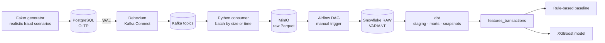

# Real-Time Banking Fraud Detection Pipeline

End-to-end data platform that captures banking transactions in real time with **Change Data Capture**, lands them in a **Snowflake** warehouse, builds **behavioural fraud features with dbt**, and trains a **machine-learning model** that is benchmarked against a rule-based baseline.

[](https://github.com/zeineb-daly/real-time-banking-fraud-pipeline/actions/workflows/ci.yml)      

---

## 1. Problem

A bank stores its operations (customers, accounts, transactions) in an **OLTP database** built for writes, not for analytics:

- running analytical queries on it slows down customer-facing operations;
- nightly batch exports leave data **one day late**, too slow to react to fraud;
- updates overwrite old values, so **history is lost**;
- about **1 % of transactions are fraudulent**, far too many to review by hand.

## 2. Solution

| Need | How it is solved |
|---|---|
| Near real-time data without loading the source DB | **Log-based CDC**: Debezium reads the PostgreSQL WAL and streams every change to Kafka |
| Durable raw history | Events land as Parquet files in an **S3-compatible landing zone** (MinIO) |
| Analytics-ready, tested data | **Airflow** loads Snowflake; **dbt** builds staging, star schema and **SCD Type 2** snapshots |
| Detect fraud | **Behavioural features** in dbt, a **rule-based baseline**, then an **XGBoost** model |
| Reproducible and safe | Everything runs with **Docker Compose**; CI with **GitHub Actions** |

## 3. Architecture



| Layer | Tool | Role |
|---|---|---|
| Source | PostgreSQL | Transactional database (`wal_level=logical`) |
| Capture | Debezium (Kafka Connect source connector) | Turns every INSERT / UPDATE / DELETE into an event |
| Transport | Apache Kafka (+ ZooKeeper, persistent volumes) | One topic per table, durable and replayable |
| Landing zone | MinIO (S3-compatible) | Raw Parquet files, partitioned by date (Bronze) |
| Orchestration | Apache Airflow | Loads MinIO → Snowflake, runs dbt snapshots |
| Warehouse | Snowflake | `RAW` (JSON in `VARIANT`) and `ANALYTICS` schemas |
| Transformation | dbt | Staging views, facts / dimensions, SCD2 snapshots, fraud features, tests |
| Machine learning | scikit-learn, XGBoost (Jupyter in Docker) | Model training and evaluation |

## 4. What I built on top of the base pipeline

**Data generation**
- Realistic synthetic data over **60 days**: each customer has a home city, 1–3 devices, a typical amount and active hours.
- **4 fraud scenarios**: `account_takeover`, `card_testing`, `balance_draining`, `rapid_transfers`.
- Deliberate **overlap** between fraud and legitimate behaviour to avoid a trivially learnable recipe: partial frauds (30 %), legitimate travel, device changes, shopping bursts, and 5 % unlabelled fraud.
- All parameters in `config.yaml`, validated at start-up.
- **PaySim, tested then set aside**: `data-generator/paysim_replay.py` replays the public PaySim dataset through the same CDC pipeline. It was not used for the model because almost every account appears only once (no history for behavioural features) and the balance columns give the fraud away.

**Pipeline reliability**
- Persistent Kafka and ZooKeeper volumes (topics survive container recreation).
- Debezium emits plain JSON without the embedded schema (~10× smaller messages).
- Consumer flushes to MinIO **by size or every 30 s**, flushes on shutdown, and commits Kafka offsets **only after** a successful upload (no data loss on crash).
- Airflow DAGs set to **manual trigger only** to control Snowflake credit usage.

**Fraud detection**
- `features_transactions` dbt model with **past-only** window functions (no data leakage).
- Rule-based baseline (`fraud_rules_baseline`) with thresholds chosen on the training period only.
- Logistic regression and XGBoost trained in a Dockerised Jupyter environment, compared against the baseline on the same time-based test split, plus a generalisation test on an unseen fraud type.

## 5. Fraud features (dbt)

Each transaction is compared with **the customer's own past behaviour**, using only information available at the time of the transaction.

| Feature | Meaning | Fraud vs normal |
|---|---|---|
| `device_age_hours` | Hours since this device was first used by the customer | median 0.1 h vs 610 h |
| `nb_tx_10min`, `nb_tx_1h` | Transactions in the last 10 min / 1 h | 4.3 vs 1.0 |
| `is_night` | Transaction between 00:00 and 04:59 | 40 % vs 4 % |
| `amount_vs_avg` | Amount ÷ customer's past average | 2.05 vs 1.06 (both very small and very large values are suspicious) |
| `is_new_device`, `is_new_country` | First time this device / country is seen for the customer | 11 % vs 5 %, 7 % vs 2 % |
| `is_new_recipient` | First transfer to this account | weak signal |
| `nb_senders_to_recipient_24h` | Distinct customers sending to the same account in 24 h (mule indicator) | weak signal |
| `nb_tx_past` | Size of the customer's history | context for the other features |

Data quality is enforced with dbt tests (`unique`, `not_null`, custom `non_negative`) and a leakage audit of every feature.

## 6. Evaluation

**Time-based split** (no random shuffling):

| Split | Period | Transactions | Frauds |
|---|---|---|---|
| Train | days 1–40 | 67,978 | 654 |
| Test | days 41–50 | 17,012 | 163 |
| Demo (held out) | days 51–60 | 17,096 | 223 |

Accuracy is not used: with ~1 % fraud, predicting "never fraud" scores 99 %. Models are compared on **precision, recall, F1 and PR-AUC**.

### Results on the test period

| Approach | Alerts | True alerts | Precision | Recall | F1 | PR-AUC |
|---|---|---|---|---|---|---|
| Rule-based baseline (3 rules) | 154 | 122 | 79 % | 75 % | 0.770 | – |
| **Logistic regression** | 157 | 139 | **89 %** | **85 %** | **0.869** | 0.938 |
| XGBoost | 150 | 134 | 89 % | 82 % | 0.856 | 0.942 |

**Recall by fraud scenario**

| Scenario | Rules | Logistic regression | XGBoost |
|---|---|---|---|
| account_takeover | 2/21 (10 %) | **19/21 (90 %)** | 9/21 (43 %) |
| balance_draining | 7/19 (37 %) | **13/19 (68 %)** | 8/19 (42 %) |
| card_testing | 92/94 (98 %) | 80/94 (85 %) | **91/94 (97 %)** |
| rapid_transfers | 21/29 (72 %) | **27/29 (93 %)** | 26/29 (90 %) |

**Key findings**

- **Both ML models beat the rules** (F1 0.87 / 0.86 vs 0.77). The gain comes from the "quiet" frauds the rules miss: account takeover recall goes from 10 % to 90 %, because the model **combines several weak signals** (recent device, unusual amount, new country…) instead of requiring one strict condition.
- **Logistic regression matches XGBoost.** PR-AUC is identical (~0.94) and the F1 gap is only 5 alerts out of 163 frauds, which is not significant. The synthetic features are largely additive, which favours a linear model. Lesson: always benchmark a simple model before choosing a complex one.
- **XGBoost relies on the expected signals**: bursts (`nb_tx_1h` 39 %, `nb_tx_10min` 12 %), device age (5 %), mule indicator (5 %), transfer type (4 %) and night (3 %).

**Generalisation test: unseen fraud types**

| XGBoost trained… | card_testing detected | Other frauds detected | Total F1 |
|---|---|---|---|
| on all scenarios | 91/94 (97 %) | 62 % | 0.856 |
| **without card_testing** | **0/94 (0 %)** | 78 % | 0.478 |

A supervised model only recognises fraud that looks like what it has already seen: without examples, a burst of micro-payments looks like a legitimate shopping session. In production, the model should therefore be **combined with rules** to cover new fraud patterns, and **retrained** when a new scenario appears.

**Methodology safeguards**

- Validation slice taken from the end of the training period (days 33–40) to choose decision thresholds; the test period is used **once**, for the final score; the demo period is never read.
- Class imbalance handled with `scale_pos_weight` (XGBoost) and `class_weight="balanced"` (logistic regression).
- A guard in the notebook stops execution if the label, `fraud_type`, an identifier, the timestamp or a rule column ends up among the features.
- 32 features: 13 behavioural features + one-hot encoded transaction type, channel and merchant category.

**Model choice for real-time scoring:** logistic regression **+ rules**. It is simpler, explainable (essential in banking) and better on quiet fraud, while the rules cover unseen patterns.

## 7. Engineering challenges solved

| Problem | Root cause | Fix |
|---|---|---|
| Kafka topics lost on restart | No persistent volume | Named volumes for Kafka **and** ZooKeeper (cluster IDs must match) |
| Consumer could not reach Kafka from the host | Advertised listener used an internal hostname | Separate internal (`kafka:9092`) and host (`localhost:29092`) listeners |
| Data stuck in the consumer | Batch size never reached at low traffic | Flush by size **or** time, flush on shutdown |
| Possible data loss on crash | Offsets auto-committed before upload | Manual offset commit after upload |
| Deletes never reached Snowflake | Consumer kept only `payload.after` | Identified; planned fix (keep `op` and `ts_ms`) |
| Credits consumed continuously | DAG scheduled every minute, CD on every push | Manual-only DAGs and CD, auto-suspending X-Small warehouse, resource monitor |
| Too-easy synthetic labels | Fraud generated from the same signals used as features | Partial frauds, legitimate noise, unlabelled fraud, generalisation test |

## 8. Project structure

```
├── data-generator/        # Faker generator, config.yaml, config.py
├── postgres/              # schema.sql
├── kafka-debezium/        # connector registration
├── consumer/              # kafka_to_minio.py
├── docker/dags/           # Airflow DAGs
├── snowflake/             # setup.sql (warehouse, database, RAW tables), cost_controls.sql
├── banking_dbt/
│   ├── models/staging/    # stg_* views
│   ├── models/marts/      # facts and dimensions
│   ├── models/features/   # features_transactions
│   ├── models/baseline/   # fraud_rules_baseline
│   └── snapshots/         # SCD Type 2
├── ml/                    # Dockerfile, export_features.py, fraud_model.ipynb, models/
├── docker-compose.yml
├── .env.example           # configuration template (copy to .env)
├── ruff.toml              # lint rules (local + CI)
└── .github/workflows/     # CI / CD
```

## 9. Getting started

**Prerequisites:** Docker Desktop, Python 3.12, a Snowflake account (trial is enough).

```bash
# 1. Configuration: only the Snowflake values must be filled in, local defaults work as-is
cp .env.example .env

# 2. Python environment for the scripts that run on the host
python -m venv .venv
source .venv/bin/activate                  # Windows: .venv\Scripts\Activate.ps1
pip install -r requirements.txt

# 3. Start the platform (airflow-init migrates Airflow and creates the admin user from .env)
docker compose up -d

# 4. Create the source schema
docker compose exec -T postgres psql -U postgres -d banking < postgres/schema.sql
#    PowerShell: Get-Content postgres/schema.sql | docker compose exec -T postgres psql -U postgres -d banking

# 5. Register the Debezium connector
python kafka-debezium/generate_and_post_connector.py

# 6. Stream data
python consumer/kafka_to_minio.py                  # terminal 1, keep it running
python data-generator/faker_generator.py --once    # terminal 2

# 7. Load Snowflake: in Airflow, trigger "minio_to_snowflake_banking"
#    (its first task creates the warehouse, database and RAW tables)

# 8. Transform: dbt reads the Snowflake credentials from environment variables
set -a; source .env; set +a
#    PowerShell: Get-Content .env | Where-Object { $_ -match '^[A-Z_]+=' } | ForEach-Object { $k, $v = $_ -split '=', 2; Set-Item "env:$k" $v }
cd banking_dbt && dbt build --profiles-dir .dbt && cd ..

# 9. Train the models (runs in Docker)
docker compose up -d jupyter
docker compose run --rm jupyter python /home/jovyan/ml/export_features.py   # one-off export to ml/data/
#    then open ml/fraud_model.ipynb at http://localhost:8888 (token = JUPYTER_TOKEN in .env)
```

| Service | URL |
|---|---|
| Airflow | http://localhost:8080 (user from `AIRFLOW_ADMIN_USER` / `AIRFLOW_ADMIN_PASSWORD`) |
| MinIO console | http://localhost:9001 |
| Kafka Connect REST | http://localhost:8083/connectors |
| Jupyter | http://localhost:8888 |

**Cost control (Snowflake)**

- `snowflake/setup.sql`, run automatically by the DAG: X-Small warehouse with `AUTO_SUSPEND = 60` and `AUTO_RESUME`.
- `snowflake/cost_controls.sql`, to run **once by hand** as `ACCOUNTADMIN` in a Snowsight worksheet: resource monitor `budget_projet` with a one-off budget of 20 credits (`FREQUENCY = NEVER`; notify at 75 %, suspend at 90 %, suspend immediately at 100 %). It uses `IF NOT EXISTS`, so re-running it never resets the credits already consumed.
- Airflow DAGs and the CD workflow only run when triggered manually.

**CI/CD**

- **CI** (every push / pull request to `main`): ruff, configuration validation, `docker compose config` and `dbt parse`. No secrets and no Snowflake connection, so no credits.
- **CD** (manual, *Actions > Run workflow*): `dbt build` on Snowflake. Requires the repository secrets `SNOWFLAKE_ACCOUNT`, `SNOWFLAKE_USER`, `SNOWFLAKE_PASSWORD`, `SNOWFLAKE_WAREHOUSE` and `SNOWFLAKE_ROLE` (a role limited to the `BANKING` database, not `ACCOUNTADMIN`).

## 10. Limitations

- Data is **synthetic**: scores measure the method, not real-world performance.
- The test period contains only 163 frauds, so small score differences between models are not significant.
- Two features (`is_new_recipient`, mule indicator) are weak because of how the generator creates transfers.
- DELETE events are not yet propagated to Snowflake.
- The consumer and generator still run on the host, not in containers.

## 11. Roadmap

- [ ] Keep CDC metadata (`op`, `ts_ms`) to handle deletes and deduplication in dbt
- [ ] Containerise the generator and the consumer
- [ ] Real-time scoring: Kafka consumer → model → `fraud_alerts` topic
- [ ] Power BI dashboard on fraud alerts and detection rates
- [ ] Anomaly detection (Isolation Forest) to complement the supervised model

## Acknowledgements

The initial CDC architecture (PostgreSQL → Debezium → Kafka → MinIO → Snowflake → dbt) comes from [UtkarshReddyNathala/Real-Time-Banking-Data-Pipeline](https://github.com/UtkarshReddyNathala/Real-Time-Banking-Data-Pipeline). I extended it with realistic fraud simulation, pipeline hardening, cost-aware orchestration, feature engineering and an ML detection layer.

## Author

**Zeineb Daly** – Data Engineering & AI student, ESILV Paris
